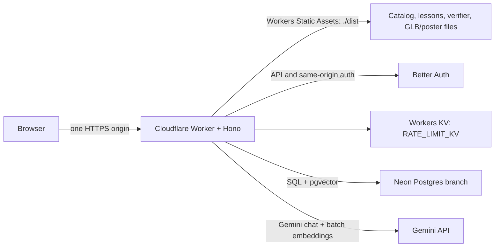

# Architecture

Perspectra is a static-first learning application with a same-origin Cloudflare Worker API. The
catalog and lesson prose render as static HTML with no client JavaScript. A progressive scene layer,
tutor, quiz, and Badge 2.0 verifier add behavior without making core learning depend on a live model.

## System shape



There is no separate Pages origin. Workers Static Assets serves `dist/`, `/health` and `/api/*`
run the Hono Worker first, and the final non-API fallback calls the `ASSETS` binding. Missing
assets and unknown routes return a real 404 rather than an SPA index response.

## Public shell and static learning path

- `src/pages/index.astro` renders the six-landmark catalog as static HTML. The catalog entry point
  contains no client JavaScript.
- `src/pages/lessons/[id].astro` renders title, preamble, scene, ground, extra-context toggles,
  provenance citations, and the manifest-referenced WebP poster fallback at build time.
- `src/components/lesson/{TutorPanel,Citation,QuizCard}.astro` deliver the tutorial, retrieval
  explanation, and self-check without changing the static source of truth.
- `src/pages/verify/index.astro` verifies OB3 credentials entirely in the browser.
- Content sync reads `src/content/lessons/*.md` and normalized GLB manifests. New lesson
  directories use the same slug as their content entry. Topic content, assets, scene/GLB assets,
  catalog copy, and static maps are data; there is no per-topic Worker code branch.

Static embeds may be reused across lessons. Their metadata remains explicit, and the verifier
cannot be used as an arbitrary embedding host.

## API and request flow

The Hono application in `api/src/index.ts` keeps routing and dependency injection explicit:

```text
/health
/api/auth/*                  Better Auth
/api/progress, /api/progress/sync
/api/tutor                   intent → quota → retrieval → Gemini → validate → SSE
/api/quiz/*, /api/mastery     grounded generation, grading, BKT/FSRS views
/api/badge/*                 OB3 issue + public verification
*                            ASSETS fallback for non-API routes
```

`api/src/routes/tutor.ts` resolves intent before model generation, computes a session-scoped
quota, retrieves only static lesson evidence, calls Gemini with temperature `1`, minimal thinking,
and a `maxOutputTokens` cap, rejects empty output or invalid lesson citations, and streams validated
text as SSE. It never accepts browser-supplied context as trusted lesson content.

`api/src/lib/llm.ts` is the Gemini-only boundary:

- Chat uses `generateContent` with the `x-goog-api-key` header; `LLM_MODEL` defaults to `gemini-3.5-flash`.
- Chat sends temperature `1` and `thinkingConfig.thinkingLevel: 'minimal'`. Because Gemini 3 includes thinking tokens in `maxOutputTokens`, minimal thinking reserves more of the retained 400-token cap for the response.
- `EMBEDDING_API_KEY` is optional and falls back to `LLM_API_KEY`.
- Embeddings use `gemini-embedding-2:batchEmbedContents`, `outputDimensionality: 1536`, and the
  `task: question answering | query:` / `title: none | text:` prefixes for asymmetric retrieval.
- The adapter requires one row per input, exactly 1536 finite numbers per row, and nonzero norm. It
  normalizes every row to unit L2 norm before returning it. Unsupported providers or embedding
  models fail fast, preventing incompatible embedding spaces.

The tutor uses the default query purpose. Lesson ingestion explicitly requests document purpose.

Production dependencies are resolved per `Request`, not cached on the reusable Worker bindings object.
One Neon serverless WebSocket `Pool` and Drizzle client serve every database operation within that
request, including Better Auth transactions. Hono middleware registers `pool.end()` with
`c.executionCtx.waitUntil` after the handler returns, so cleanup cannot block the response and no
WebSocket crosses request contexts. `neon-http` is not used because Better Auth requires interactive
transactions.

## Data and progression

```text
lesson 1 ──< lessonEmbedding vector(1536)       canonical text + normalized Gemini vectors
hotspot * ──1 lesson                            static landmarks and evidence anchors
event * ──1 user                                append-only behavioral facts
user 1 ──< progress                             question stats, knowledge, and FSRS due dates
quizAttempt * ──1 user                          grounded answers and teacher-model grading
badgeCredential 1 ──1 user                      OB3 proof and state
```

`progress` is a materialized view with a deterministic projector from events. Knowledge state uses
BKT mastery and FSRS scheduling; a learning event can be derived from more than one source. Hotspot
revisits are idempotent, and sync accepts only a bounded idempotency-key batch under the request
size limit.

Drizzle migrations live in `api/drizzle/`. The production branch receives `pnpm db:push`, canonical
seed data, and a Gemini embedding ingest that preserves NDJSON dry-runs and database upserts.

## Authentication, quotas, and safety

- Better Auth's required release path uses Google OAuth and email/password in both development and
  production. GitHub OAuth remains in the provider code but is explicitly deferred by the user and is
  not required for this release. Browser requests remain same-origin; `BETTER_AUTH_URL` is the final
  workers.dev origin.
- `RATE_LIMIT_KV` is a Worker KV binding for per-IP rate limits and session-scoped quotas. The real
  namespace id is injected into an ignored deployment config by `pnpm deploy:prepare`; only the
  32-zero placeholder is committed.
- Tutor requests create a server-side Gemini usage session before generation. A typed quorum
  summarizer reports when evidence is insufficient.
- Badge proofs embed the issuer, criteria, evidence, and custody values. The browser verifier
  recomputes OB3 `proofValue` using the server-side HMAC-SHA-256 secret and derives the public key
  from the same secret without receiving it.
- Disclosure and privacy notices remain visible before first tutor use. Anonymous and authenticated
  telemetry do not place secrets or raw prompts in browser logs.

## Rendering, assets, and the runtime budget

`src/lib/scene/` owns the WebGL/WebGPU lifecycle. A remote model is lazy-loaded only when its turn
arrives; local landmarks are keyboard reachable and support click, focus, and reduced-motion
interaction. Scene failures step down to WebGL and then to the manifest-referenced WebP poster
with retry. The three.js vendor bundle is split from application code and served from the same
Worker origin.

The heart lesson's 960×960 WebP poster is checked into `public/assets/heart/` and its PNG remains
the deterministic source for the Blender export. The integration contract requires the referenced
WebP to be under 120,000 bytes so it stays eligible for LCP. The runtime budget and Lighthouse
gates are defined in `tests/e2e/performance.spec.ts`. The catalog must carry zero JavaScript, the
static entry must remain below the enforced gzip budget, and public pages must meet configured
accessibility, best-practice, performance, and SEO budgets.

## Operational boundaries

Deployment, real Cloudflare/Neon resources, production credentials, manual OAuth setup, and
production E2E are human-only operations described in `docs/DEPLOYMENT.md`. Local verification
uses injected ports, in-memory repositories, fetch stubs, and a Playwright preview or explicitly
configured external origin; it never substitutes a model response for grounded evidence.
