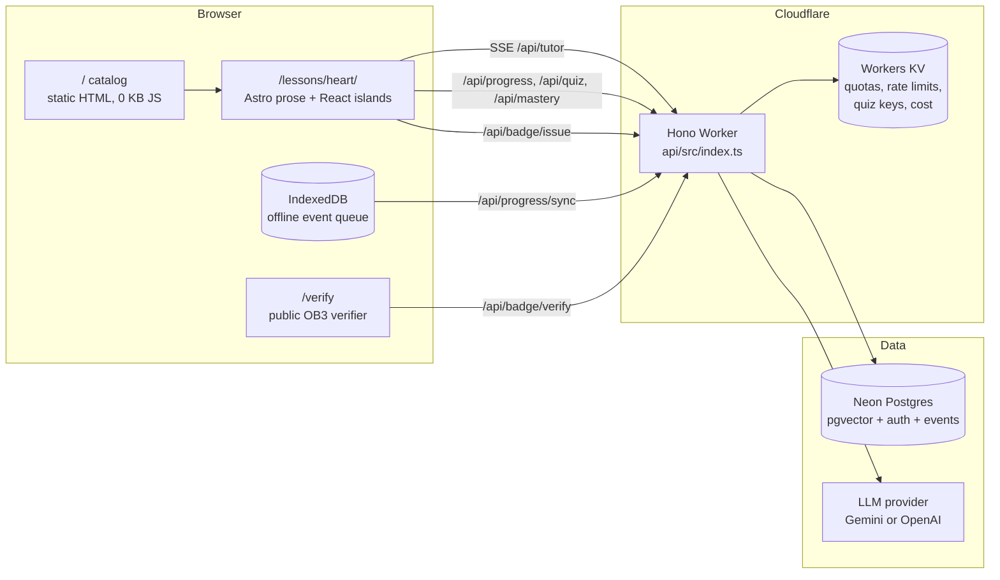

# Perspectra architecture

## System shape



The static shell is built by Astro; only the lesson and verifier pages hydrate React/Astro islands. The Worker is the single place that reads secrets. Nothing in `src/**` or `dist/**` contains an API key.

## Request flow: grounded tutor

1. `POST /api/tutor` validates `{lessonId, question, sessionId?, activeHotspot?, history?}` with Zod (question ≤ 1000 chars, history ≤ 16 turns).
2. `classifyIntent` rejects off-topic questions **before any generation** and returns a static MDX excerpt.
3. `checkQuota` applies anonymous (2/day), authenticated (60 requests, 150k tokens), 16-turn, and $10/month kill-switch gates in Workers KV.
4. `retrieveChunks` scores embedded MDX chunks with `0.7 × cosine + 0.3 × normalized lexical`, enforcing a cosine floor.
5. `assemblePrompt` emits four named layers — `GLOBAL CONTEXT`, `INSTRUCTIONAL RULES`, `ADAPTIVE VARIABLES`, `POST-INTERACTION CONTRACT` — plus source chunks and the question.
6. `llm.complete` returns the full answer. The Worker validates `[[chunk-id]]` markers against the retrieved IDs; an invalid citation produces an `error` event and **no** answer deltas.
7. The Worker paces validated text as SSE `data:` lines:

   ```text
   data: {"type":"delta","text":"The aorta carries oxygenated blood. "}

   data: {"type":"delta","text":"[[heart:aorta:overview]]"}

   data: {"type":"done","citations":["heart:aorta:overview"]}

   ```

   Errors use `{"type":"error","code":"...","message":"...","staticExcerpt":"..."}` and keep the response at HTTP 200 where practical so the prose lesson is never blocked (NFR-6).

## Contracts

### Scene manifest (Zod)

`src/lib/scene-manifest.ts` validates frontmatter for the `lessons` collection:

```ts
sceneManifestSchema = z.object({
  title: z.string(),
  topic: z.string(),
  description: z.string(),
  status: z.enum(['live', 'draft']),
  order: z.number(),
  model: z.object({ src: z.string(), poster: z.string(), scale: z.number().optional() }),
  camera: z.object({ position: vec3Schema, target: vec3Schema }),
  hotspots: z.array(z.object({
    id: z.string().regex(/^[a-z][a-z0-9_]*$/),
    label: z.string(),
    position: vec3Schema,
    focus: vec3Schema.optional(),
  })),
});
```

`validateHotspotReferences(mdxSource, manifest, { requireAll: true })` runs at build time: every `data-hotspot="..."` in the MDX must exist in the manifest and every manifest hotspot must appear in the prose. The canonical heart IDs are `left_ventricle`, `right_ventricle`, `aorta`, `pulmonary_artery`, `mitral_valve`, `aortic_valve`.

### Hotspot ↔ prose binding

`src/lib/hotspot-store.ts` is a small zustand store. `focusHotspot(id)` sets the active hotspot, holds a 1200 ms focus lock for camera tween stability, and scrolls `[data-hotspot="<id>"]` into view with reduced-motion-aware behavior. `ProseHotspotBinder` observes prose sections and sets the store on scroll; `SceneIsland` reflects the store in `data-active-hotspot` and drives the camera target. Keyboard users get equivalent `<button data-hotspot-button>` controls.

### Event and progress API

Events are append-only and Zod-validated:

```ts
learningEventSchema = z.object({
  id: z.string(),
  lessonId: z.string(),
  hotspotId: z.string(),
  type: z.enum(['view', 'answer', 'quiz_result', 'reflection']),
  payload: z.record(z.string(), z.unknown()).default({}),
  timestamp: z.number().int().nonnegative(),
});
```

- `GET /api/progress` → `{userId, lessons, eventCount}` built by last-write-wins per hotspot.
- `POST /api/progress` → append one event (120 writes/min/user via KV).
- `POST /api/progress/sync` → dedupe by event ID, then LWW by `(timestamp, id)`.
- `src/lib/offline-queue.ts` mirrors the merge in IndexedDB with `mergeEvents(local, remote)` and `toSyncBatch(events)`.

### Mastery model

`api/src/lib/mastery.ts` is pure and deterministic:

- `bktUpdate(prior, correct, {learn = 0.25, slip = 0.1, guess = 0.2})`:
  `posterior = correct ? pKnown / (pKnown + guess·(1−pKnown)) : (1−pKnown) / ((1−pKnown) + slip·pKnown)`,
  then `next = posterior + (1 − posterior) × learn`, clamped to `[0, 1]`.
- `computeMastery(events, hotspots)` replays `answer`/`quiz_result` events ordered by `(timestamp, id)`, starting from a 0.2 prior. It also advances `ts-fsrs` cards (`FSRS`, `createEmptyCard`, `Rating`; retention 0.9, fuzz off, max interval 36 500 days).
- View shape: `{hotspots:[{hotspotId, mastery, attempts, correct, dueAt}], updatedAt, overall}` with a 0.85 threshold and `recommendNext(view)` choosing the weakest unmastered hotspot.

### Quiz protocol

- `POST /api/quiz/generate` (authenticated) asks the LLM for JSON restricted to the target hotspot's MDX section. The Worker validates `{id, hotspotId, question, options[4], answerIndex, explanation, remediationId}` and stores `{userid, question}` in KV under `quiz:<userId>:<id>` for 3600 s. The response omits `answerIndex` and `explanation`.
- `POST /api/quiz/grade` reads that KV record (404 on miss or wrong user), appends exactly one stable-id `quiz_result` event `quiz:<questionId>:<userId>`, and returns `{correct, explanation, remediationId, mastery, nextHotspot, dueCards}`.
- `GET /api/mastery` returns the mastery view plus `nextHotspot` and `dueCards`.

### Badge proof model

`api/src/lib/badge.ts` issues an Open Badge 3.0 credential:

```json
{
  "@context": [
    "https://www.w3.org/2018/credentials/v1",
    "https://purl.imsglobal.org/spec/ob/v3p0/context.json"
  ],
  "type": ["VerifiableCredential", "OpenBadgeCredential"],
  "issuer": { "id": "https://perspectra.example", "name": "Perspectra" },
  "credentialSubject": { "achievement": { "name": "Human Heart Mastery", "criteria": { "narrative": "..." } } },
  "proof": {
    "type": "DataIntegrityProof",
    "cryptosuite": "hmac-sha256",
    "proofPurpose": "assertionMethod",
    "created": "...",
    "proofValue": "..."
  }
}
```

The signature is `base64url(HMAC-SHA-256(canonicalJsonWithoutProof, BETTER_AUTH_SECRET))`; the encoded credential is `base64url(json) + "." + signature`. `verify` strips `proof`, canonicalizes, recomputes the HMAC with timing-safe comparison, and never throws. This is a portfolio-scale integrity check, not Ed25519/Decentralized Identifiers.

Issue requires all six hotspots ≥ 0.85 (otherwise 403 with the failing IDs). `POST /api/badge/verify` is public and powers `/verify`.

## Failure posture

WebGPU failure → WebGL → poster. LLM outage, quota denial, off-topic question, or malformed citation → SSE error event plus a static MDX excerpt. Auth failure → sign-in prompt. Database failure on progress sync → queued events stay in IndexedDB and retry. In every case the prose lesson remains readable and navigable.

## License notes

Runtime code is MIT. Shipped heart assets are CC0/OFL. Z-Anatomy and BodyParts3D were consulted as reference only and are not distributed. `ts-fsrs`, `three`, React, Astro, Hono, Drizzle, Better Auth, and the tooling stack keep their respective open-source licenses; no dependency contributes client-side secrets.
